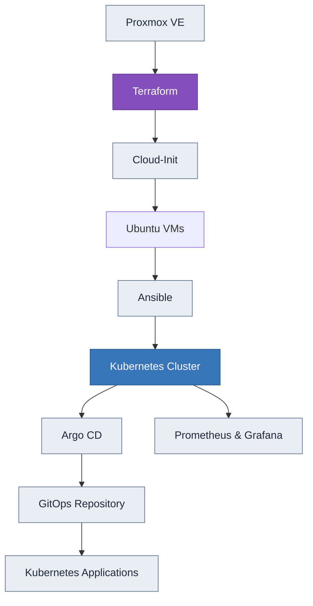
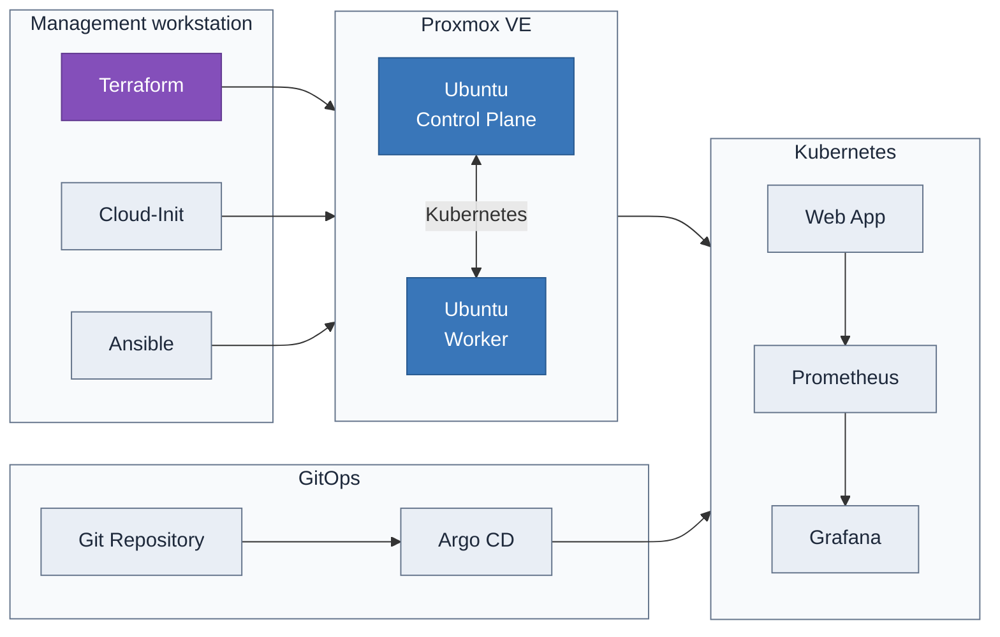

# Proxmox Kubernetes Homelab

**Infrastructure as Code · Automation · Kubernetes · GitOps · DevOps**

A self-hosted Kubernetes homelab built on Proxmox VE, designed to explore infrastructure automation, configuration management, container orchestration and GitOps practices.

The project aims to provision and configure a Kubernetes cluster using **Terraform, Cloud-Init and Ansible**, then manage application deployments through **Argo CD** and GitOps.

Rather than relying on manual configuration, the objective is to make infrastructure reproducible, version-controlled and maintainable through automation.

## Architecture



### Infrastructure workflow

1. **Terraform** provisions virtual machines on Proxmox VE using a reusable Ubuntu template.
2. **Cloud-Init** handles the initial configuration of each VM, including the hostname, user account, SSH access and required system components.
3. **Ansible** automates system configuration and Kubernetes installation, separating common configuration from control-plane and worker-specific tasks.
4. **Kubernetes** provides the container orchestration layer for running applications.
5. **Argo CD** will manage Kubernetes deployments through a GitOps workflow, keeping the cluster configuration synchronized with the Git repository.
6. **Prometheus and Grafana** will provide monitoring and visualization of cluster and application metrics.

## Tech Stack

| Technology                                             | Purpose                                              |
| ------------------------------------------------------ | ---------------------------------------------------- |
| [Proxmox VE](https://www.proxmox.com/)                 | Virtualization and infrastructure hosting            |
| [Terraform](https://developer.hashicorp.com/terraform) | Infrastructure provisioning (IaC)                    |
| [Cloud-Init](https://cloud-init.io/)                   | Automated VM initialization                          |
| [Ansible](https://www.ansible.com/)                    | Configuration management and Kubernetes installation |
| [Ubuntu](https://ubuntu.com/)                          | Operating system for virtual machines                |
| [Kubernetes](https://kubernetes.io/)                   | Container orchestration                              |
| [Argo CD](https://argo-cd.readthedocs.io/)             | GitOps continuous delivery                           |
| [GitHub Actions](https://github.com/features/actions)  | CI and configuration validation                      |
| [Prometheus](https://prometheus.io/)                   | Metrics collection                                   |
| [Grafana](https://grafana.com/)                        | Monitoring and dashboards                            |

## Infrastructure Diagram




## Infrastructure

The cluster is hosted on a self-managed Proxmox VE server. Due to the hardware resources currently available, the initial architecture uses two Ubuntu virtual machines.

| Component     | Role                                              |
| ------------- | ------------------------------------------------- |
| Control Plane | Kubernetes API, cluster management and scheduling |
| Worker        | Runs containerized workloads                      |
| Proxmox VE    | Hosts and manages the virtual machines            |

The infrastructure is provisioned using Terraform, with a `for_each`-based VM configuration to make it easier to manage and extend the cluster as resources become available.

### Terraform

Terraform is responsible for defining and provisioning the virtual infrastructure.

Key objectives:

* Infrastructure defined declaratively and version-controlled.
* Reusable VM configuration through input variables.
* Automated cloning from an Ubuntu cloud image template.
* Cloud-Init integration for initial VM configuration.
* Separation of infrastructure configuration, variables and provider settings.
* Reproducible infrastructure provisioning through Terraform plan and apply.

Terraform is executed locally against the Proxmox API. Infrastructure provisioning is deliberately kept separate from the GitHub Actions workflows, which focus on configuration validation rather than accessing the hypervisor.

### Cloud-Init

Cloud-Init automates the initial configuration of virtual machines during provisioning.

The configuration includes:

* Hostname assignment.
* Creation of the `ubuntu` user.
* SSH public key injection.
* Initial system configuration.
* Python and QEMU Guest Agent installation.

This allows Ansible to connect to consistently initialized virtual machines without requiring manual setup.

### Ansible

Ansible is used to automate operating system configuration and Kubernetes cluster deployment.

The playbooks are organized around reusable roles and separate responsibilities to make the configuration easier to maintain.

The intended configuration workflow includes:

* Common system configuration across all nodes.
* Preparation of Kubernetes prerequisites.
* Control-plane initialization.
* Worker node configuration and cluster joining.
* Kubernetes networking configuration.

Ansible connects to the managed nodes over SSH and uses Python on the target machines to execute its modules.

## Kubernetes & GitOps

The Kubernetes cluster is the foundation for running and managing containerized workloads.

The next stage of the project is to integrate Argo CD and implement a GitOps deployment workflow.

With GitOps, Kubernetes application configurations are stored in Git and reconciled by Argo CD, reducing the need for manual deployment operations.

The planned implementation includes:

* Argo CD installation and bootstrap.
* Declarative application configuration.
* Automated synchronization from a Git repository.
* Deployment of a sample application.
* Separation of application manifests from infrastructure provisioning.

## CI & Code Quality

GitHub Actions is used to automate validation and enforce basic quality checks on infrastructure configuration.

The CI workflows are designed to validate configuration files without requiring access to the Proxmox host or exposing infrastructure credentials.

Planned and implemented checks include:

* **Terraform:** formatting and configuration validation.
* **Cloud-Init:** YAML syntax and configuration linting.
* **Ansible:** playbook syntax validation and inventory checks.
* **Pre-commit:** local code quality checks, including `ansible-lint`.

Terraform provisioning and deployment remain local operations, while CI provides automated feedback on changes submitted to the repository.

## Repository Structure

```text


.
├── .github/
│   └── workflows/
│       ├── terraform.yml
│       ├── cloud-init.yml
│       └── ansible.yml
│
├── ansible/
│   ├── inventory/
│   │   └── hosts.ini
│   └── playbooks/
│       ├── k8s-master.yml
│       └── k8s-setup.yml
│
├── cloud-init/
│   └── user_data.yml
│
├── terraform/
│   ├── main.tf
│   ├── outputs.tf
│   ├── variables.tf
│   ├── versions.tf
│   ├── terraform.tfvars.example
│   └── terraform.tfvars
│
├── .gitignore
├── .pre-commit-config.yaml
└── README.md

.

.
├── .github/
│   └── workflows/
│       ├── terraform.yml
│       ├── cloud-init.yml
│       └── ansible.yml
│
├── ansible/
│   ├── ansible.cfg
│   ├── inventory/
│   │   └── hosts.ini
│   └── playbooks/
│       ├── k8s-master.yml
│       └── k8s-setup.yml
│
├── cloud-init/
│   └── user_data.yml
│
├── terraform/
│   ├── main.tf
│   ├── outputs.tf
│   ├── variables.tf
│   ├── versions.tf
│   ├── terraform.tfvars.example
│   └── terraform.tfvars
│
├── kubernetes/
│   ├── bootstrap/
│   └── manifests/
│
├── gitops/
│   ├── argocd/
│   ├── apps/
│   └── monitoring/
│
├── app/
│
├── .gitignore
├── .pre-commit-config.yaml
└── README.md
```

*The structure represents the intended organization of the project and may evolve as additional components are implemented.*

## Project Status

| Component                           | Status      |
| ----------------------------------- | ----------- |
| Proxmox VE setup                    | Completed   |
| Terraform VM provisioning           | Implemented |
| Ubuntu Cloud-Init configuration     | Implemented |
| Terraform CI validation             | Implemented |
| Cloud-Init CI validation            | Implemented |
| Ansible configuration and inventory | Implemented |
| Ansible playbooks and roles         | Implemented |
| Kubernetes cluster automation       | Implemented |
| Argo CD integration                 | Planned     |
| GitOps application deployment       | Planned     |
| Prometheus and Grafana              | Planned     |

## Roadmap

* [x] Set up the Proxmox VE environment.
* [x] Define the virtual machine infrastructure using Terraform.
* [x] Integrate Cloud-Init for automated VM initialization.
* [x] Implement Terraform and Cloud-Init validation workflows.
* [x] Finalize Ansible inventory and playbooks.
* [x] Automate Kubernetes control-plane and worker configuration.
* [x] Validate cluster networking and node communication.
* [ ] Deploy and configure Argo CD.
* [ ] Implement a GitOps workflow for application deployments.
* [ ] Deploy a sample containerized application.
* [ ] Integrate Prometheus and Grafana.
* [x] Document the architecture, deployment process and operational procedures.

## Security & Best Practices

Security and maintainability are considered throughout the project.

* **Automated validation:** GitHub Actions and pre-commit hooks are used to detect configuration and syntax issues before deployment.
* **Pinned Github Actions:** GitHub Actions dependencies are referenced using full commit SHA hashes instead of mutable version tags, ensuring that workflow dependencies remain tied to specific revisions.
* **Infrastructure as Code:** infrastructure configuration is version-controlled and managed declaratively with Terraform.
* **Secrets management:** sensitive values such as API tokens and credentials are kept out of the Git repository. The terraform.tfvars.example file provides a template for the required variables without exposing sensitive values.
* **SSH authentication:** SSH keys are used for access to managed virtual machines.
* **Least privilege:** access permissions are intended to be scoped to the requirements of each component.
* **Configuration validation:** automated checks help detect configuration errors before deployment.
* **Separation of concerns:** Terraform handles infrastructure provisioning, Cloud-Init initializes virtual machines, and Ansible handles system configuration.

## Goals & Learning Outcomes

This project is intended to provide hands-on experience with real-world DevOps and infrastructure engineering practices.

The main objectives are to:

* Automate the provisioning and configuration of virtual infrastructure.
* Develop maintainable Infrastructure as Code.
* Manage Linux systems using configuration management.
* Deploy and operate a Kubernetes cluster.
* Implement GitOps-based application delivery.
* Build CI workflows for infrastructure validation.
* Introduce observability and monitoring for distributed workloads.
* Apply security and automation principles throughout the infrastructure lifecycle.


## Getting Started

### Prerequisites

Before deploying the infrastructure, make sure you have:

- A running Proxmox VE server with API access.
- Terraform installed on your local machine.
- An SSH key pair for connecting to the virtual machines.
- An Ubuntu Cloud Image configured as a **Proxmox VM template**, with Cloud-Init support enabled.
- The required Proxmox permissions and storage configured for VM provisioning.

### 1. Configure the Proxmox Template

Before using Terraform, you must create and configure an Ubuntu VM template in Proxmox VE.

The template should be based on a compatible Ubuntu Cloud Image and have Cloud-Init support configured. It should also include the QEMU Guest Agent if required by your Terraform configuration.

Make sure to note the template's VM ID, Proxmox node and storage configuration, as these values may be required by Terraform.

### 2. Configure Terraform

Navigate to the Terraform directory:

```bash
cd terraform
```

Create your local variables file from the provided example:

```bash
cp terraform.tfvars.example terraform.tfvars
```

Edit `terraform.tfvars` to configure your Proxmox environment, including your api token, VM settings and other required variables.

Ensure that sensitive values are not committed to the repository.


###  3. CPU Configuration

Depending on your host CPU, you may need to configure the CPU type of your virtual machines to ensure compatibility with hardware virtualization.

For older processors, such as the **AMD Athlon II**, the `kvm64` CPU type can be used to provide a compatible virtual CPU model.

In the Terraform configuration, make sure the CPU type is set according to your host's capabilities and the requirements of your virtual machines.

For newer processors, the `host` CPU type may be used to expose the host CPU features directly to the virtual machines, provided it is supported by your environment.

Refer to the [Proxmox VE documentation](https://pve.proxmox.com/pve-docs/) for further details on CPU types and virtualization compatibility.

### 4. Initialize and Provision the Infrastructure

Initialize Terraform:

```bash
terraform init
```

Validate the configuration:

```bash
terraform validate
```

Review the planned infrastructure changes:

```bash
terraform plan
```

If the plan is correct, provision the virtual machines:

```bash
terraform apply
```

Terraform will create the virtual machines on Proxmox using the configured template and Cloud-Init settings.

### 5. Configure the Virtual Machines with Ansible

Once the virtual machines have been provisioned and Cloud-Init has completed, configure the Ansible inventory in `ansible/inventory/hosts.ini` with the appropriate VM addresses and connection details.

From the project root, run the relevant playbook:

```bash
ansible-playbook -i ansible/inventory/hosts.ini ansible/playbooks/k8s-setup.yml
```

Run the remaining Kubernetes configuration playbook when the initial setup is complete:

```bash
ansible-playbook -i ansible/inventory/hosts.ini ansible/playbooks/k8s-master.yml
```

### 5. Verify the Infrastructure

After configuration, verify that the virtual machines are reachable over SSH and that the Kubernetes components have been installed and configured as expected.

Further steps, including Argo CD installation, GitOps deployment and monitoring, will be documented as they are implemented.

---

**Author:** Henri Gey Bechalier
**Project:** Proxmox Kubernetes Homelab
**Focus:** DevOps · DevSecOps · Infrastructure as Code · Kubernetes · GitOps
